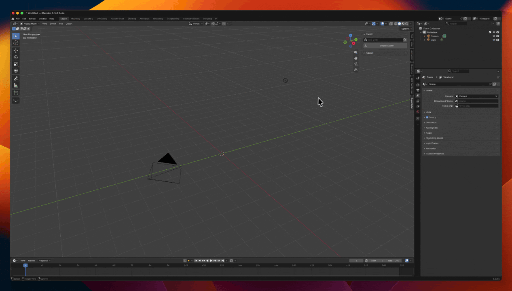

# SuperSplat for Blender

Scene: [The Fruit Bowl](https://superspl.at/scene/d8ba72a6) by SuperDelphi,
[CC BY 4.0](https://creativecommons.org/licenses/by/4.0/).

Import Gaussian-splat scenes from [SuperSplat](https://superspl.at) into Blender by link, and
publish your own splats to SuperSplat. Requires Blender 5.3 or later.

Only scenes whose owners allow downloads can be imported. Scenes without downloads enabled
can be viewed on superspl.at but not imported. To find scenes you can import, browse the
[downloadable scenes](https://superspl.at/search?features=downloadable&sort=trending) on superspl.at.

## Install

1. Download the zip from [Releases](https://github.com/playcanvas/supersplat-blender-extension/releases).
   In Blender, open **Edit > Preferences > Get Extensions**, choose **Install from Disk** in the
   drop-down menu at the top right and pick the zip.
2. Enable **Preferences > System > Network > Allow Online Access**. Import and Publish need it.

## Quick start

1. **Get a key.** Open **Edit > Preferences > Add-ons > SuperSplat** and press
   **Manage API Keys**. Sign in at [playcanvas.com/account](https://playcanvas.com/account), go to **API Tokens** and press **Generate Token**.
   Paste the token in the key field and press **Save Key**.
2. **Import a scene.** Pick one from the
   [downloadable scenes](https://superspl.at/search?features=downloadable&sort=trending). In the
   3D Viewport press N and open the **SuperSplat** tab, paste its link and press **Import Scene**.
3. **Publish a splat.** Select a Gaussian splat object and press **Publish to SuperSplat**.

Import and Publish run in the background. Press Esc, **Cancel Import** or **Cancel Publish** to
stop them.

## Features

### Import

- Paste a `superspl.at/scene/<id>` link, a `superspl.at/s?id=<id>` link or a scene ID. The scene
  must have downloads enabled by its owner.
- Press the magnifier to look a scene up first. The panel shows its author, license, format and
  splat count.
- For SSOG scenes, pick the **Detail** level (finest by default) and whether to import the
  **Environment**. The environment is a separate object parented to the scene.
- After an import the options fold away. Press **Import Again…** to change them and import the
  scene once more.
- The scene arrives upright at the 3D cursor, named after the scene, selected and framed in the
  view.
- The **Attribution** panel shows the active object's title, author and license, with
  **View on SuperSplat** and **View License**. Credits for every imported scene are collected in
  the `SuperSplat Attributions` text block.

### Publish

- Exports the selected splat as a standard 3DGS PLY and uploads it. New scenes are unlisted.
- Set a title and description. Both are optional.
- **Convert Axes for SuperSplat** applies the object's transform and converts Blender's Z-up to
  the 3DGS convention, so the scene stands upright in SuperSplat. It is on by default.
- Lower the spherical-harmonics degree under **Advanced** to make the file smaller.
- When the upload finishes, use **Continue in SuperSplat**, **Open Viewer** or **Copy Link**.
- A scene imported with this extension publishes back with its original coordinates.

Blender 5.3 imports 3DGS PLY files with **File > Import > Stanford PLY**. Objects with
non-uniform scale, shear or mirroring cannot be published.

## What gets sent

The extension only talks to SuperSplat when you press a button. Nothing is sent automatically.

- **Import** sends the scene ID to SuperSplat and downloads the scene.
- **Publish** uploads the exported PLY with its title and description. It also sends the
  extension's name and version.
- Your API key authenticates each request to the SuperSplat API.

The key is never written to Blender preferences. On macOS it is stored in your login Keychain.
On Windows and Linux it is stored in a file in the extension's user folder that only you can read.

## Troubleshooting

### "Online access is off"

Enable **Preferences > System > Network > Allow Online Access**.

### 401 Unauthorized

The key is wrong or has been revoked. Generate a new token, paste it in the SuperSplat preferences
and press **Save Key**.

### Daily download limit reached

Your account has reached today's download limit. Try again the next day.

### "Not downloadable"

The scene's owner has not enabled downloads, so it can't be imported. Owners decide whether their
scenes can be downloaded; please respect that choice.

### macOS asks for Keychain access

Allow Blender to access the key.

## Support

Report bugs and ask questions in
[GitHub Issues](https://github.com/playcanvas/supersplat-blender-extension/issues). To build or
test the extension, see [CONTRIBUTING.md](CONTRIBUTING.md).

## License

[MIT](LICENSE)
